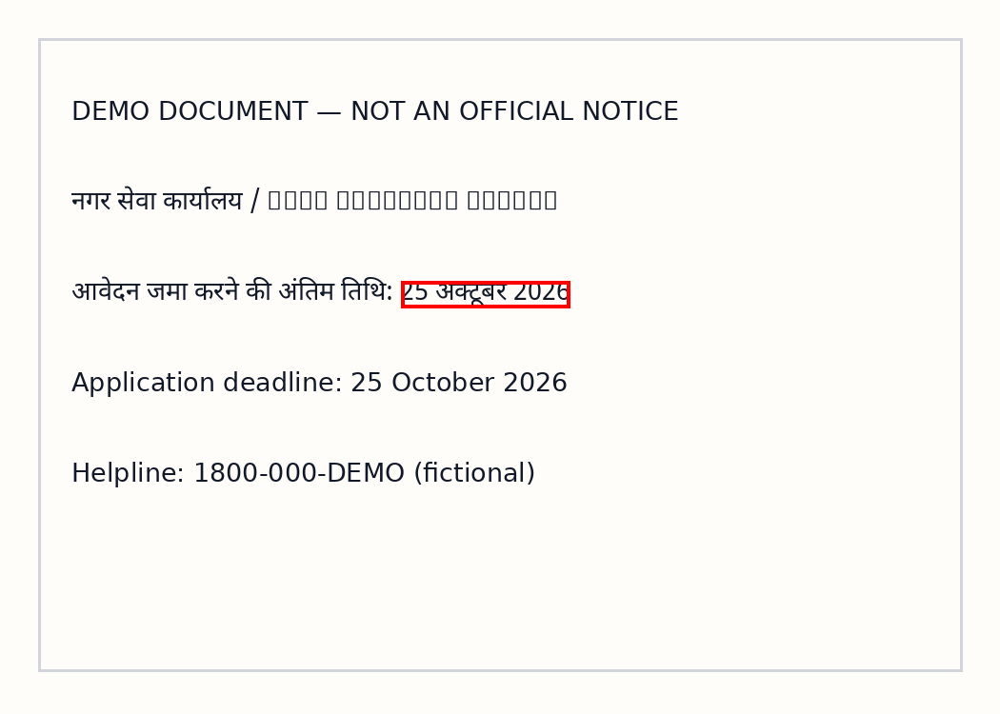

# DocLens-VLM — Evidence-Grounded Visual Document Search

**A visual document retrieval + evidence-grounded Q&A prototype** for scanned PDFs, forms, invoices, and multilingual administrative documents. Compare OCR/BM25 with pretrained visual retrieval, inspect the retrieved page, and require located OCR/PDF spans before displaying candidate answers.



**Stack:** Python · PyTorch · ColPali-style MaxSim · ColSmol · SmolVLM · Tesseract OCR · BM25 · Gradio

**Status:** CPU unit tests passed (56). GPU inference and real ViDoRe performance **not yet measured**. The screenshot is fictional demonstration data.

**Research prototype.** Reimplements *ColPali-style late interaction* (MaxSim) and builds a practical PDF/scan question-answering app using two small, pretrained vision-language models. Its goal is to evaluate when **retrieving whole page images** beats the traditional **OCR → text search** workflow.

> **Status:** Source implementation and CPU unit tests are verified. The included 3-page fictional-data smoke experiment is verified. Pretrained ColSmol and SmolVLM inference, real ViDoRe benchmark scores, Indic generalization, and any training benefits **have not been validated** in the local CPU environment. Run the T4 notebook to generate real results.

## The research connection

- **Faysse et al., [ColPali: Efficient Document Retrieval with Vision Language Models](https://proceedings.iclr.cc/paper_files/paper/2025/hash/99e9e141aafc314f76b0ca3dd66898b3-Abstract-Conference.html), ICLR 2025.** We implement the central MaxSim scoring mechanism locally:
  `score(q,p) = sum_i max_j cosine(query_token_i, page_token_j)`.
- **Pretrained retriever:** [`vidore/colSmol-500M`](https://huggingface.co/vidore/colSmol-500M), a small visual document retriever from the ColPali family. Unlike the original paper's model-scale training, this checkpoint is used as published.
- **Pretrained answerer:** [`HuggingFaceTB/SmolVLM-500M-Instruct`](https://huggingface.co/HuggingFaceTB/SmolVLM-500M-Instruct). Generates short answers from retrieved page images. Answers are labelled *unverified*.
- **Sarvam relevance:** Indian-language document intelligence, layout preservation, key-value extraction, and grounded visual processing. This project is independent of Sarvam and does not use or reproduce Sarvam Vision weights.

## What it does

1. Upload PDFs or scanned document images (Hindi / English); render pages and keep full-page imagery.
2. Build **OCR BM25** (text baseline) and **ColSmol MaxSim** (visual VLM retrieval) indexes.
3. Ask a question in English or an Indic script; get ranked pages and scores.
4. Optional: generate a **literal candidate answer** with the separate 500M VLM. Show it only if it matches one unique same-line OCR/PDF text span with an actual image-pixel bounding box; otherwise explicitly abstain (`Not visible in the document.`). Page/region citation is supported, **not** independently verified fact correctness.
5. Evaluate page retrieval with MRR, Recall@5, nDCG@5, and paired bootstrap CI against a real small ViDoRe subset **after actually running the pretrained model**. Separately evaluate answer correctness, false support, false abstentions, and evidence-box IoU against human annotations.
6. Experimental low-rank trainable token adapter and InfoNCE objective; **not trained by default**, not a claim of full VLM fine-tuning.

### System

```text
PDF / scanned image -> page renderer -> page images + optional embedded PDF text
                                          |                           |
                              Visual VLM encoder              OCR / PDF text
                                  [page tokens]                    [words]
                                          |                           |
Question -> VLM text tokens -> custom MaxSim ranking       BM25 ranking baseline
                                          |
                                  Top retrieved page
                                          |
                              SmolVLM answer generation
                                          |
                      LITERAL OCR/PDF SPAN VERIFIER
                             |                 |
                       unique box        none/ambiguous
                             |                 |
                        proposed answer    ABSTAIN
                        + page + bbox
```

## Quickstart — CPU baseline (no GPU needed)

```bash
pip install -e '.[tests]'
python scripts/make_demo.py
python -m doclens.cli ingest assets/*.png --out runs/demo --ocr --ocr-languages eng+hin
python -m doclens.cli search 'When is the application deadline?' --corpus runs/demo --mode bm25
python -m pytest -q
python app.py
```

For Hindi OCR, install the **system Tesseract binary** plus `eng` and `hin` traineddata. The Python `pytesseract` binding is included. The demo images are explicitly fictional and cannot be used as quantitative evidence. Existing corpora indexed before the evidence upgrade must be re-ingested to acquire genuine word boxes.

## T4 Colab — actual pretrained visual models

Open [`notebooks/DocLens_VLM_T4.ipynb`](notebooks/DocLens_VLM_T4.ipynb) after uploading `DocLens-VLM_GitHub_Ready.zip` to Colab. It installs dependencies, creates a small **real** ViDoRe subset, runs both BM25 and visual retrieval on exactly the same images/queries, reports measured metrics, and optionally generates a page-grounded answer.

CLI equivalent:

```bash
pip install -e '.[vision,evaluation,tests]'
python scripts/import_vidore.py --n 50 --seed 42 --out runs/vidore
# IMPORTANT: perform OCR for the BM25 baseline; see notebook Cell 4
python -m doclens.cli index-visual --corpus runs/vidore
python -m doclens.cli evaluate --queries runs/vidore/queries.json --corpus runs/vidore --mode visual -k 5
python -m doclens.cli ask 'What is the deadline?' --corpus runs/your_documents --mode visual
```

Large model downloads require network access. The T4 is 16GB; one model is loaded at a time in the notebook. We have not verified its peak GPU memory usage; reduce batch/pool size if necessary.

## Evaluation & falsifiable hypotheses

**H1:** Visual MaxSim retrieval improves nDCG@5 over OCR BM25 on visually challenging pages. **Unverified.**

**H2:** Those gains remain under document degradations and Indian-language scripts. **Unverified; requires a separate well-labelled Indic benchmark.**

**H3:** A small learned low-rank token adapter improves performance on unseen document templates. **Unverified.** `doclens/adapter.py` contains an efficient experiment primitive; it requires separate train/validation/test labels and cannot train on evaluation samples.

**Key controls:** Equal candidate page pool, equal question set and k, paired bootstrap by question, no tuning on the test split, retrieval metrics separated from grounded-answer accuracy. OCR quality is a confounder and should be reported by language and scan quality. Models can hallucinate answers even with a correct retrieved page.

## Files

| Path | Role |
|---|---|
| `doclens/late_interaction.py` | Chunked, normalized PyTorch MaxSim & InfoNCE (paper method) |
| `doclens/evidence.py` | Unique literal-span localization, evidence provenance and abstention |
| `doclens/grounding_eval.py` | Evaluation of answer accuracy, false support, false abstention and bbox IoU with annotated gold labels |
| `AGENTS.md` and `.agents/skills/doclens-vlm/SKILL.md` | Codex and repository-wide operational rules |
| `doclens/vision.py` | Pretrained ColSmol page/query encoders, embedding index |
| `doclens/adapter.py` | Optional low-rank token projection extension |
| `doclens/lexical.py` | Unicode-aware BM25 baseline |
| `doclens/corpus.py` | PDF/image ingestion and local page rendering |
| `doclens/generator.py` | VLM proposal followed by strictly abstaining localized text support |
| `doclens/evaluate.py` | MRR/Recall/nDCG and paired bootstrap |
| `scripts/import_vidore.py` | Reproducible sampled real ViDoRe retrieval eval |
| `notebooks/DocLens_VLM_T4.ipynb` | GPU execution walkthrough |
| `app.py` | Gradio document assistant |

## Responsible use / limits

No identity documents, confidential bank records, patient records or production data in publicly hosted demos. Files stay local by default. OCR/PDF-located strings are **not proof of semantic or pixel-level correctness** and require review of the source image. MaxSim retrieval does not provide region coordinates. Documents with absent, duplicate, damaged or untranslated evidence may cause conservative abstention. The retrieval scores are similarities, **not confidence probabilities**. No promise of strong Hindi/Indian-language accuracy from predominantly English-trained weights. Commercial/licensing use depends on each upstream model/dataset license.

## Optional learned visual-retrieval adapter

`doclens/adapter.py` reimplements a trainable low-rank residual token adapter and in-batch contrastive objective. `scripts/train_adapter.py` is a real training entrypoint that *requires explicit disjoint TRAIN and VALIDATION annotations* and forbids positive-page or question overlap. Weights are trained on **frozen pretrained VLM embeddings** to fit a T4; this must not be presented as training a new foundational VLM. Example:

```bash
python scripts/train_adapter.py --corpus runs/your_documents \
  --train datasets/train_queries.json --valid datasets/valid_queries.json \
  --steps 120 --rank 8 --out runs/adapter.pt
```

This is an **unexecuted experimental extension**, not a measured improvement. Keep a separate untouched test split for any final reported result.

## Practical invoice / circular fields

The Gradio app also shows **conservative** fields detected in PDF text or OCR output: invoice number, total payable, application deadline, and meeting date. Fields are null when absent, and every result is accompanied by its source page. Textual substring evidence is *not* proof of a correct reading of the original pixels; this module is an auditable prototype rather than a production decision system.

## Evidence grounding and conservative abstention (October 2026 upgrade)

For selectable-text PDFs, ingestion preserves PDF word rectangles transformed to
rendered pixel coordinates. For scans, ingestion uses Tesseract `image_to_data`
words and coordinates (enable `--ocr`). Both paths preserve Unicode strings and
line identifiers; a VLM-produced candidate must match a **unique exact
contiguous same-line span** to be displayed. Matching regions are highlighted
in red, and responses include `source`, 1-based `page`, image-pixel bbox,
normalized bbox and the origin (`pdf_text_layer` or `tesseract_ocr`). With
missing/duplicated/unlocatable content the answer is exactly
`Not visible in the document.`

This is deliberately **more conservative than a normal VLM**. It frequently
abstains on paraphrased, multi-line or OCR-damaged text. The rule cannot ensure
zero hallucinations: a candidate could match a real but unrelated number on
another part of the page; OCR might mis-transcribe; semantics still need human
verification. Do not call `text_span_supported` an independently verified
answer. Evidence coordinates cannot be inferred from ColPali MaxSim attention.

A separate human-labeled evaluation format is available:

```json
[
  {
    "page_id": "EXACT_PAGE_ID_FROM_CORPUS",
    "model_proposal": "25 अक्टूबर 2026",
    "expected_answer": "25 अक्टूबर 2026",
    "gold_page_id": "EXACT_PAGE_ID_FROM_CORPUS",
    "gold_bbox_pixels": [421, 295, 598, 323]
  }
]
```

Replace IDs, answers, and coordinates with **independently annotated real
labels**. Don't reuse the example coordinates as benchmark gold labels.

```bash
python -m doclens.grounding_eval --corpus runs/your_documents \
  --labels your_human_labeled_questions.json --out grounding_results.json
```

The evaluator reports supported/abstained fractions, supported-answer
precision, false support on gold-absent questions, false abstention on
answer-present questions, and bbox IoU when gold coordinates exist. This is
an *evaluation scaffold*; no grounded-answer benchmark has yet been run on
real documents. Local synthetic smoke tests do not establish reliability.

**Hardware:** MaxSim now processes document tokens in bounded chunks and
retrieval streams one `.npz` page at a time. Model loading and full ViDoRe
metrics remain to be validated on a real T4.

## Audit robustness patch: items 2, 8, 9, 10, 12 (2026-10-14)

- **Value normalization:** Both gold answer and model proposal are compared using
  `doclens.fields.comparison_tokens`. Unicode digits, monetary symbols,
  surrounding plus/minus signs, parentheses and punctuation are normalized
  symmetrically; `₹500`, `$500`, `-500`, `($500)` and `500` are equivalent **for
  textual evaluation only**. The policy is intentionally **sign-insensitive**
  per the audit request; do not use these comparisons to validate balances,
  payments, or account debits. Original extracted values remain unchanged.
  Exact token boundaries prevent `500` matching `5000`.
- **PDF page coverage:** The regular ingestion cap is 30 pages per PDF.
  A longer PDF emits a warning and writes `ingestion_manifest.json` recording
  omitted pages; every subsequent BM25/visual search exposes a coverage warning.
  To index all pages and clear the warning, run:

  ```bash
  python -m doclens.cli ingest document.pdf --out runs/corpus --max-pages 0
  ```

  Missing content in an incompletely indexed document must **not** be construed
  as evidence that the answer is absent. The GUI also shows the warning.
- **Incremental ingestion:** Re-running `ingest` into the same `--out` directory
  merges by content-addressed page ID, preserves existing documents, and keeps
  older OCR text/coordinates when an incoming re-index is less informative.
  `corpus.json` and the coverage manifest are written with same-directory atomic
  replacement. Corrupt or duplicate IDs in existing corpus files are rejected.
  ViDoRe import refuses to clobber a different existing benchmark corpus.
- **EXIF orientation:** Phone images are auto-transposed before OCR, hashing,
  saved page images and VLM encoding, so box coordinates refer to the visible
  upright orientation.
- **BM25 empty index:** With no pages, search returns `[]`. With indexed pages
  but no searchable OCR/PDF text, BM25 raises a descriptive `ValueError` instead
  of emitting zero-score rankings as if retrieval succeeded. For scanned pages
  use `--ocr` (Tesseract language packs required), or visual retrieval.

Run `python -m pytest -q` and `python -m compileall -q doclens app.py`.

**Scope:** These are local correctness and safety fixes, not new GPU / ViDoRe
benchmark measurements or validated financial-semantic equivalence.
